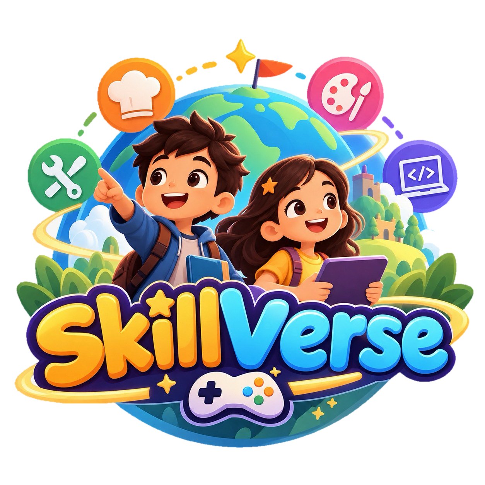
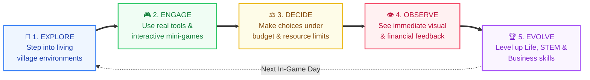
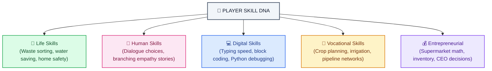
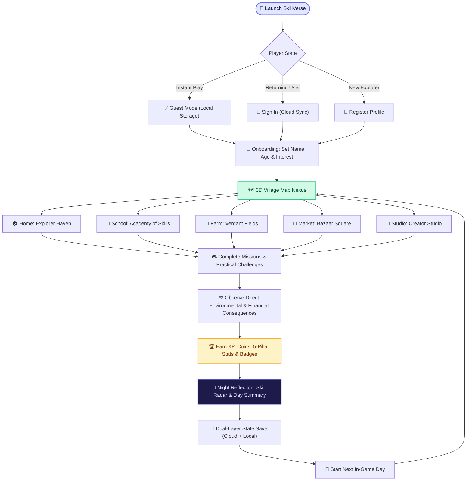
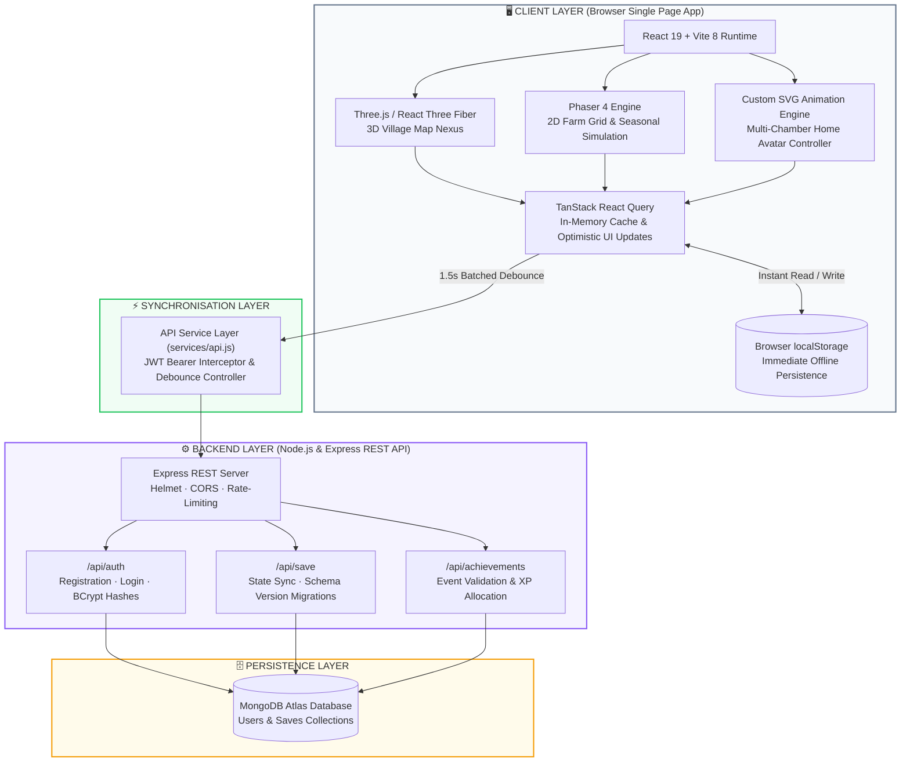

<div align="center">



# 🌟 SKILLVERSE
### 🎮 *Live a Day. Learn a Life.* 🚀
**A Gamified Vocational & Experiential Learning Universe for Young Minds**

<br/>

[](#)
[](#)
[](#)

<br/>

[](https://react.dev/)
[](https://vitejs.dev/)
[](https://threejs.org/)
[](https://phaser.io/)
[](https://tailwindcss.com/)
[](https://expressjs.com/)
[](https://www.mongodb.com/)

</div>

---

## 📌 Quick Navigation

- [🎯 The Problem](#-the-problem)
- [🌟 The Vision](#-the-vision)
- [⚡ The Paradigm Shift](#-the-paradigm-shift)
- [🌱 What is SkillVerse?](#-what-is-skillverse)
- [✨ Core Capabilities](#-core-capabilities)
- [🧠 5-Pillar Progression System](#-5-pillar-progression-system)
- [🌍 The 5 Learning Worlds](#-the-5-learning-worlds)
  - [🏠 1. Explorer Haven — Home World](#-1-explorer-haven--home-world)
  - [🏫 2. Academy of Skills — School World](#-2-academy-of-skills--school-world)
  - [🌾 3. Verdant Fields — Farm World](#-3-verdant-fields--farm-world)
  - [🛒 4. Bazaar Square — Market World](#-4-bazaar-square--market-world)
  - [🎨 5. Creator Studio](#-5-creator-studio)
- [🔄 Journey & Gameplay Flow](#-journey--gameplay-flow)
- [🏛️ Full-Stack System Architecture](#-full-stack-system-architecture)
- [🛠️ Complete Technology Stack](#-complete-technology-stack)
- [📂 Repository Blueprint](#-repository-blueprint)
- [🚀 Quickstart & Installation](#-quickstart--installation)
- [🧪 Testing & Verification](#-testing--verification)
- [🗺️ Development Roadmap](#-development-roadmap)
- [👥 Meet the Team](#-meet-the-team)
- [📜 License](#-license)

---

<br/>

<div align="center">

# 🎯 The Problem

</div>

Children learn concepts in class but rarely get the chance to *practice* them — decision-making, money management, digital literacy, sustainability, and entrepreneurial thinking are all skills built through repetition, not memorization.

This gap is echoed by real frameworks, not just our assumption:

| Source | What it says |
| :--- | :--- |
| 🇮🇳 **NEP 2020** | Mandates experiential & vocational learning from Grade 6 onward |
| 🏛️ **Ministry of Education** | Calls for vocational education to be more accessible, flexible & inclusive |
| 🌍 **UNICEF India** | Identifies decision-making, empathy, teamwork & goal-setting as core life skills best learned through real practice |

SkillVerse gives children a **safe, low-risk sandbox** to make decisions, see consequences, and learn from mistakes — right when habits are forming (ages 11–14).

---

<br/>

<div align="center">

# 🌟 The Vision

</div>

> **Children learn best by doing, not memorising.**

SkillVerse turns abstract textbook theory into an interactive coastal village where every building is an opportunity to practice real-life skills. Instead of passively reading about ecology, commerce, or coding, young learners explore spaces, make consequential choices, and discover practical competencies through play.



---

<br/>

<div align="center">

# ⚡ The Paradigm Shift

</div>

| Dimension | ❌ The Conventional Way | ✅ The SkillVerse Innovation |
| :--- | :--- | :--- |
| **Learning Format** | **Textbook Theory:** Passive memorisation of disconnected facts with no real context. | **Living Village Simulation:** Contextual 3D environments where knowledge is applied in daily routine. |
| **Feedback Loop** | **Zero Practice:** Static end-of-chapter tests with delayed grading and zero consequence. | **Genuine Agency:** Real-time feedback with visible in-game, ecological, and economic outcomes. |
| **Skill Outcome** | **Fragmented Knowledge:** High test marks, yet unprepared for real-world independent life. | **5-Pillar Practical Mastery:** Holistic, experiential muscle memory built through repeated decision-making. |

---

<br/>

<div align="center">

# 🌱 What is SkillVerse?

</div>

> **SkillVerse is an interactive life-simulation universe designed to bridge the gap between classroom theory and real-world competence.**

Through a dynamic, day-in-the-life coastal village simulation, young minds step into authentic roles — managing a home, navigating STEM discovery labs, cultivating climate-smart crops, and directing market commerce.

Rather than relying on passive memorization or static quizzes, SkillVerse immerses players in consequential challenges:
* 🚰 **Tackling domestic crises:** Diagnosing water leaks and enforcing electrical safety.
* 💰 **Exercising financial agency:** Budgeting household groceries under strict ₹100 constraints and calculating real-time retail change.
* 🌾 **Managing finite resources:** Balancing seasonal irrigation against drought to operate a sustainable farm.
* 💻 **Thinking computationally:** Debugging real Python code syntax and wiring live electrical circuits.

Every action creates tangible feedback that directly evolves the player's **5-Pillar Skill DNA** (*Life, Human, Digital, Vocational, and Entrepreneurial*).

<div align="center">

### *“Live a Day. Learn a Life.”* — Experiential mastery built on genuine agency. 🚀

</div>

---

<br/>

<div align="center">

# ✨ Core Capabilities

</div>

* 🗺️ **3D Village Realm** — Top-down coastal world rendered in Three.js with ocean shaders and click-to-enter district portals.
* 🏃 **Avatar Movement Engine** — Smooth keyboard and touch locomotion across multi-room spaces with real-time obstacle collision.
* 🧠 **5-Pillar Skill DNA** — Continuous progression system tracking Life, Human, Digital, Vocational, and Entrepreneurial growth.
* 🏆 **Milestone Achievements** — 5-tier badge unlock engine with level-up rewards, celebratory toasts, and profile showcases.
* ☁️ **Dual-Layer Persistence** — Zero-friction offline play via `localStorage` paired with automatic background cloud sync to MongoDB Atlas.
* 🎮 **Interactive Simulations** — Domain mini-games including circuit wiring, Phaser 4 crop farming, atom balancing, and supermarket till operations.

---

<br/>

<div align="center">

# 🧠 5-Pillar Progression System

</div>

Instead of letter grades or standardized test scores, SkillVerse tracks holistic competence across five practical pillars:



---

<br/>

<div align="center">

# 🌍 The 5 Learning Worlds

</div>

---

### 🏠 1. Explorer Haven — Home World
> 🧭 **Focus:** Domestic Sustainability & Home Safety &nbsp;•&nbsp; **Pillar:** `Life Skills`

* **📦 What's Inside:** Waste sorting bins (wet/dry/e-waste), ₹100 grocery budgeting challenge, leaking pipe repair, electrical safety detective quiz, and morning routine sequencing.
* **💡 What Child Learns:** Waste segregation habits, nutritional prioritization within a budget, water conservation facts, hazard prevention, and daily personal responsibility.

---

### 🏫 2. Academy of Skills — School World
> 🔬 **Focus:** Applied STEM & Communication &nbsp;•&nbsp; **Pillars:** `Digital Skills` & `Human Skills`

* **📦 What's Inside:** Interactive typing dojo, Python bug debugging, live electrical circuit wiring, atomic mass assembler, mental math rapids, and empathy dialogue builder.
* **💡 What Child Learns:** Algorithmic thinking and code debugging, physical STEM concepts through hands-on labs, fast arithmetic, and respectful conversational conflict resolution.

---

### 🌾 3. Verdant Fields — Farm World
> 🚜 **Focus:** Climate-Smart Agriculture & Agronomics &nbsp;•&nbsp; **Pillar:** `Vocational Skills`

* **📦 What's Inside:** 4-season agricultural calendar (Spring to Winter), dynamic weather & finite water reserves, 12 regional crops (Wheat, Bajra, Mustard, etc.), and agronomic cards.
* **💡 What Child Learns:** Kharif/Rabi/Zaid crop cycles, drought water rationing, why heat-resilient crops thrive in warming climates, and agricultural business economics.

---

### 🛒 4. Bazaar Square — Market World
> 📊 **Focus:** Commerce, Numeracy & Leadership &nbsp;•&nbsp; **Pillar:** `Entrepreneurial Skills`

* **📦 What's Inside:** 2D interactive supermarket with shelf stocking and cash register till, paired with an executive CEO Decision Room tackling quarterly corporate challenges.
* **💡 What Child Learns:** Real-time cashier change calculations, inventory supply chain logistics, balancing short-term profits against brand trust, and leadership ethics.

---

### 🎨 5. Creator Studio
> 🛠️ **Focus:** Civic Engineering & Visual Storytelling &nbsp;•&nbsp; **Pillars:** `Vocational Skills` & `Human Skills`

* **📦 What's Inside:** World Builder pipeline crisis routing water under budget, Invention Lab mechanical workbench (gears & motors), branching story studio, and community poster atelier.
* **💡 What Child Learns:** Designing public municipal utilities within resource constraints, mechanical gear ratios, ethical branching narrative outcomes, and impactful visual communication.

---

<br/>

<div align="center">

# 🔄 Journey & Gameplay Flow

</div>



---

<br/>

<div align="center">

# 🏛️ Full-Stack System Architecture

</div>



---

<br/>

<div align="center">

# 🛠️ Complete Technology Stack

</div>

| Category | Core Technology | Primary Role in SkillVerse |
| :--- | :--- | :--- |
| **Frontend Framework** | [React 19](https://react.dev/) + [Vite](https://vitejs.dev/) | Component architecture, responsive state & rapid HMR |
| **3D World Engine** | [Three.js](https://threejs.org/) + [R3F](https://r3f.docs.pmnd.rs/) | Top-down 3D village map with custom water shaders |
| **2D Simulation** | [Phaser 4](https://phaser.io/) | Agricultural grid tile physics & crop cycle simulation |
| **Styling & UI** | [TailwindCSS 4](https://tailwindcss.com/) + [Motion](https://motion.dev/) | Modern dark-mode styling and micro-animations |
| **Backend & Cloud API** | [Node.js](https://nodejs.org/) + [Express 4](https://expressjs.com/) | RESTful API server for identity and cloud save sync |
| **Database & ODM** | [MongoDB Atlas](https://www.mongodb.com/) + [Mongoose](https://mongoosejs.com/) | Cloud persistence for player progression and badges |
| **Security & Auth** | [JWT](https://jwt.io/) + [bcryptjs](https://github.com/dcodeIO/bcrypt.js) | Authenticated sessions with hashed credentials |

---

<br/>

<div align="center">

# 📂 Repository Blueprint

</div>

```text
SkillVerse/
├── public/                       # Static public assets (logo, avatars, 3D GLB models)
├── src/                          # Frontend Application Source (React 19)
│   ├── main.jsx                  # Entry point with LoaderGate
│   ├── App.jsx                   # Central route architecture & route protection
│   ├── config/locations.js       # Registry for all world coordinates & metadata
│   ├── pages/                    # Core top-level page views (Home, School, Farm, Market, Studio)
│   ├── features/                 # Modular domain feature slices
│   │   ├── achievements/         # 5-tier badge registry & event processing
│   │   ├── auth/                 # Authentication context & JWT token management
│   │   ├── computer/             # Typing tutor, block coding, Python debugging
│   │   ├── english/              # Quiz games, word vault, dialogue builders
│   │   ├── farm/                 # Phaser 4 crop simulation & weather engine
│   │   ├── home/                 # Multi-room avatar layouts & 12 mini-games
│   │   ├── market/               # Skillz Market simulator & CEO Decision Room
│   │   ├── player/               # usePlayer hook: state orchestrator & cloud sync
│   │   ├── science/              # Biology, Chemistry, Physics sub-hubs & labs
│   │   ├── studio/               # World Builder, Invention Lab, Story Studio, Design Atelier
│   │   └── world/                # 3D and SVG interactive village map components
│   └── services/                 # API client (Axios/fetch) & saveManager.js
├── server/                       # Backend REST Application (Node.js/Express)
│   ├── src/models/               # User.js and Save.js Mongoose schemas
│   └── src/routes/               # /auth, /save, /achievements endpoints
└── docs/                         # WORLD_PROGRESS_GUIDE.md integration docs
```

---

<br/>

<div align="center">

# 🚀 Quickstart & Installation

</div>

### Step 1: System Requirements
- **Node.js:** `v18.0.0` or higher ([Download](https://nodejs.org/))
- **npm:** `v9.0.0` or higher
- **MongoDB:** Local instance (`mongodb://localhost:27017`) or free [MongoDB Atlas](https://www.mongodb.com/atlas) cluster

---

### Step 2: Clone the Project
```bash
git clone https://github.com/your-username/SkillVerse.git
cd SkillVerse/IEEE_GamifiedLearning
```

---

### Step 3: Install Frontend & Backend Dependencies
```bash
# Install frontend packages (in root)
npm install

# Install backend packages
cd server
npm install
cd ..
```

---

### Step 4: Configure Environment Variables
```bash
cp server/.env.example server/.env
```
Edit `server/.env` with your settings:
```env
PORT=5000
MONGODB_URI=mongodb://localhost:27017/skillverse
JWT_SECRET=skillverse_super_secret_jwt_key_2026
JWT_EXPIRES_IN=7d
CLIENT_ORIGIN=http://localhost:5173
```

---

### Step 5: Run the Backend & Frontend Servers
In terminal 1 (Backend):
```bash
cd server
npm run dev
```
In terminal 2 (Frontend):
```bash
npm run dev
```

Open **`http://localhost:5173`** in your browser. Choose **Guest Mode** for instant offline play, or create an account for full cloud saves!

---

<br/>

<div align="center">

# 🧪 Testing & Verification

</div>

SkillVerse includes dedicated test suites for its simulation models, story graphs, and achievement engines:

```bash
# Run all Creative Studio test suites (World Builder, Story Studio, Engine)
npm run test:studio

# Run Story Studio branching, export, and schema tests
npm run test:story

# Run World Builder pipeline network and construction budget tests
npm run test:world

# Run Market World cashier logic and CEO decision tests
npm run test:market

# Run Achievement Engine milestone validation tests
npm run test:achievements
```

---

<br/>

<div align="center">

# 🗺️ Development Roadmap

</div>

| Phase | Milestone | Status |
| :--- | :--- | :---: |
| **Phase 1** | **Core Exploration:** 3D village map, Home World avatar movement, 12 stations | ✅ Complete |
| **Phase 2** | **STEM & Vocational Wings:** Typing tutor, Python debugging, Phaser 4 crop grid | ✅ Complete |
| **Phase 3** | **Commerce & Economy:** Skillz Market cashiering, CEO Decision Room simulation | ✅ Complete |
| **Phase 4** | **Creative Studio:** World Builder pipeline crisis, Story Studio branching narratives | ✅ Complete |
| **Phase 5** | **Cloud & Resilience:** Dual-layer persistence, JWT auth, MongoDB Atlas integration | ✅ Complete |
| **Phase 6** | **Expansion (Planned):** Animal husbandry in Farm World, multiplayer collaborative builders | 🔄 In Progress |

---

<br/>

## 👩‍💻 Meet the Team — *The CodeX*
**Sardar Vallabhbhai National Institute of Technology · Surat, Gujarat**

| Avatar | Member | Role | Owns |
| :---: | :--- | :--- | :--- |
|  | **Samridh Sethi** *(Lead)* | 🏫 School World Lead | Communication & Digital Lab: body-language challenge, teamwork game, typing & coding puzzles |
|  | **Shiva Shankar Malekar** | 🏠 Home World Lead | Water-leak event, electrical-safety decisions, waste-sorting |
|  | **Shaurya Prajapati** | 🌾 Farm World Lead | Crop grid, water-budget allocation, weather events, sustainability dashboard |
|  | **Arpita Soholkar** | 🛒 Market World Lead | Sell-to-buyer flow, negotiation mini-game, profit calculation |
|  | **Lavanya Choukiker** | 📢 Marketing Lead | Ad creation, packaging mini-games, customer-reaction scoring |
|  | **Shreya Patil** | ⚙️ Systems & Integration Lead | Shared game-state schema, day loop, XP/coins/badges |

---

<br/>

<div align="center">

# 📜 License

</div>

Built for the **IEEE WIE ILS 2026 National Hackathon** at Sardar Vallabhbhai National Institute of Technology (SVNIT), Surat. Distributed under the **MIT License**.

---

<div align="center">


<br/>

### *Live a Day. Learn a Life.*

**Crafted with 💜 for IEEE WIE ILS 2026 National Hackathon**<br/>
<sub><em>Empower to Inspire: Thriving Together for an Inclusive and Sustainable Future</em></sub>

</div>
